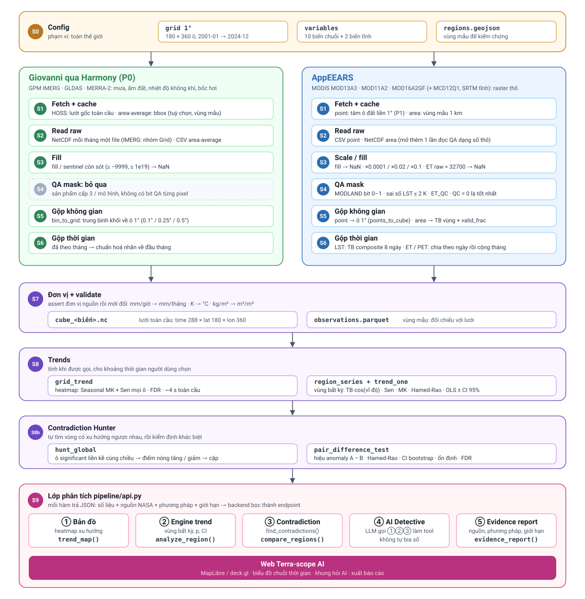

# 01 — Thiết kế Data Pipeline

Pipeline phục vụ web **Terra-scope AI**. Phạm vi là **toàn thế giới**. Đầu vào là dữ liệu từ **AppEEARS** và **Giovanni** (Giovanni lấy qua **Harmony**, gồm cả dịch vụ cắt lưới HOSS).

Pipeline làm các việc sau:
1. Biến dữ liệu thành **lưới tháng toàn cầu 1°** cho từng biến.
2. Tính xu hướng cho **mọi ô** hoặc cho **vùng bất kỳ** người dùng vẽ, trong khoảng thời gian người dùng chọn.
3. Tự tìm các vùng có xu hướng ngược nhau.
4. Trả kết quả cho web và AI qua một lớp hàm phân tích.

Code của từng bước ở **03**, chi tiết adapter ở **02**, thuật toán Contradiction Hunter ở **05**.

---

## 1. Sơ đồ tổng thể



- **Cột xanh lá (Giovanni qua Harmony, P0):**
  - HOSS lấy lưới gốc toàn cầu của mưa, ẩm đất, nhiệt độ không khí và bốc hơi.
  - Area-average lấy chuỗi cho vùng mẫu.
  - S4 bị bỏ qua (khung nét đứt).
- **Cột xanh dương (AppEEARS):**
  - Point request tại tâm các ô đất liền 1° cho NDVI, LST, ET/PET (P1).
  - Area request 1 km cho vùng mẫu, dùng để kiểm chứng lưới.
- **Khối tím (S7–S8b):** dùng chung. Đầu ra chính là `cube_<biến>.nc`.
- **Khối hồng (S9):** `pipeline/api.py`, mỗi hàm ứng với một tính năng chính của web.

---

## 2. Danh sách stage

| Stage | Việc làm | Input | Output |
|---|---|---|---|
| **S0** Config | Lưới 1°, giai đoạn, danh mục biến, vùng mẫu | — | `config/regions.geojson`, hằng số trong code (mục 4) |
| **S1** Fetch + cache | Gọi API, chờ, tải; không tải lại cái đã có | config | `data/raw/{harmony_grid,appeears,giovanni}/…` |
| **S2** Read raw | Mở file thô thành mảng / bảng có trục thời gian | file raw | `xarray.DataArray` / `DataFrame` |
| **S3** Scale / fill | Fill → NaN, nhân scale, cắt miền hợp lệ | S2 | giá trị vật lý |
| **S4** QA mask | Bỏ pixel kém chất lượng theo bit QA (chỉ AppEEARS) | S3 + layer QA | mảng đã lọc |
| **S5** Gộp không gian | Lưới gốc → ô 1°; point → ô 1°; vùng mẫu → trung bình vùng | S4 | mảng 1° / chuỗi vùng |
| **S6** Gộp thời gian | Đưa về tháng, nhãn đầu tháng | S5 | chuỗi tháng |
| **S7** Đơn vị + validate | Đổi đơn vị chuẩn có assert, kiểm tra, ghi file | S6 | `cube_<biến>.nc`, `observations.parquet` |
| **S8** Trends | Heatmap cả lưới; xu hướng cho vùng bất kỳ | cube | kết quả trend (tính khi được gọi) |
| **S8b** Contradictions | Tự tìm điểm nóng tăng / giảm, kiểm định khác biệt từng cặp | cube | bảng điểm nóng + bảng cặp |
| **S9** Lớp phân tích + export | Hàm cho web / AI / báo cáo; JSON mặc định cho lần tải trang đầu | S7–S8b | dict JSON, `web/data/*.json` |

---

## 3. Chi tiết từng stage

### S0 — Config

**Input:** quyết định của team. **Output:** các hằng số và một file vùng mẫu.

1. Lưới phân tích: `STEP = 1.0` độ, tâm ô tại −89.5 … 89.5 và −179.5 … 179.5, tức 180 × 360 ô (`pipeline/grid.py`).
2. Giai đoạn: `2001-01-01 → 2024-12-31`, 288 tháng.
3. Danh mục biến: `VARIABLES` trong `pipeline/giovanni_adapter.py` (ID Giovanni → tên chuẩn) và trong `pipeline/api.py` (tên hiển thị, đơn vị, nguồn).
4. `config/regions.geojson`: **vùng mẫu** dạng bbox, dùng để kiểm chứng lưới bằng dữ liệu 1 km. Không phải phạm vi phân tích.

### S1 — Fetch + cache

**Input:** config + `EARTHDATA_USER` / `EARTHDATA_PASS` trong `.env`. **Output:** file thô trong `data/raw/`.

1. **Giovanni qua Harmony, lưới toàn cầu (P0):**
   1. Chạy `download_grid.py`. Với mỗi biến, gửi một Harmony job: `Request(collection, temporal 2001–2024, variables=[tên biến HOSS], format="application/x-netcdf4")`, không bbox, nghĩa là cả Trái Đất.
   2. Chờ xong, tải mọi file tháng về `data/raw/harmony_grid/<VAR_ID>/`; lưu `job_id.txt`.
   3. File đã có thì không tải lại (`overwrite=False`). Biến đã có `cube_<biến>.nc` thì bỏ qua.
2. **AppEEARS point trên lưới (P1):**
   1. Lấy danh sách ô đất liền từ cube GLDAS (ô có giá trị), rồi ghi CSV theo đợt bằng `write_grid_points()`.
   2. Mỗi đợt: `appeears.py point <đợt>.csv <layers> 01-01-2001 12-31-2024 <out>`.
3. **AppEEARS area cho vùng mẫu:**
   1. `sh download_appeears.sh`: R1 MOD13A3 · R2a/R2b MOD11A2 ngày/đêm · R3 MOD16A2GF · R4 tĩnh MCD12Q1 + SRTMGL3.
   2. Định dạng `netcdf4`, projection `native`.
4. **AppEEARS, chung:** poll `GET /task/{id}` mỗi 30 s. Lỗi mạng hoặc phản hồi lạ được bỏ qua để poll tiếp. Mất kết nối thì chạy `appeears.py fetch TASK_ID OUT_DIR`.
5. **Giovanni area-average (vùng mẫu, tuỳ chọn):** mỗi (vùng × biến) một Harmony job `average="area"`, trả CSV. Trước mỗi đợt gọi `quota_guard()`.

**Kiểm tra đầu ra:**
- Mỗi biến HOSS có đủ 288 file tháng.
- AppEEARS: checksum bundle khớp.
- Mỗi job area-average có đúng 1 CSV.

### S2 — Read raw

**Input:** file trong `data/raw/`. **Output:** `xarray.DataArray (time, lat, lon)` hoặc `DataFrame`.

1. **HOSS:** `read_grid_file()`.
   - IMERG nằm trong nhóm `Grid`, chiều gốc (time, lon, lat), được chuyển về (time, lat, lon).
   - GLDAS và MERRA-2 là file phẳng (time, lat, lon). ✅ file thật 13/11.
   - IMERG ghi `time` theo lịch julian (cftime); `build_cube` lấy nguyên ngày trên nhãn rồi đưa về đầu tháng.
2. **AppEEARS area:** mở một lần bằng `xr.open_dataset(nc, mask_and_scale=False)` (số thô), rồi tự decode fill / scale / QA (`decode_layer`), để tránh bẫy QC fill.
3. **AppEEARS point:** `pd.read_csv`, mỗi layer một cột ⚠️.
4. **Giovanni area-average:** metadata kết thúc ở dòng chỉ có `,`, phần sau là CSV `time, mean_<VAR>`.

**Kiểm tra đầu ra:** trục `time` tăng dần, không trùng; đúng tên chiều.

### S3 — Scale / fill

1. **AppEEARS:**
   1. Fill → NaN: NDVI `-3000`; LST `0`; ET/PET `32767`.
   2. ET/PET: raw `> 32700` (mã đặc biệt: nước, đô thị, đất trống…) → NaN.
   3. Nhân scale nếu chưa được áp: NDVI ×0.0001; LST ×0.02; ET/PET ×0.1 (`ensure_scaled`, 03 §C).
   4. Cắt theo `valid_range` (NDVI −0.2..1).
2. **Giovanni / HOSS:** `_FillValue` được xarray tự che; sentinel còn sót (≤ −9999, ≥ 1e19) → NaN.

**Kiểm tra đầu ra:** NDVI trong [−0.2, 1]; LST trong [150, 400] K.

### S4 — QA mask (chỉ AppEEARS)

1. NDVI: `_1_km_monthly_VI_Quality` bit 0–1 == 0.
2. LST ngày / đêm: `QC_Day` / `QC_Night` bit 0–1 == 0, **hoặc** bit 0–1 == 1 và bit 6–7 ≤ 1 (sai số ≤ 2 K).
3. ET / PET: không lọc QA thêm (`et_valid_only`), vì MOD16A2GF là bản gap-filled (03, K5); chỉ bỏ mã đặc biệt > 32700 ở S3.
4. Không bao giờ lọc QA theo fill value: `QC_Day` / `QC_Night` khai fill = 0, nhưng 0 là chất lượng tốt nhất.

**Kiểm tra đầu ra:** in tỷ lệ pixel giữ lại cho mỗi request (khoảng 20–95%).

### S5 — Gộp không gian

1. **HOSS → ô 1°:** `bin_to_grid()`.
   - Trung bình mọi ô nguồn có tâm trong ô 1°: IMERG 0.1° góp 100 ô, GLDAS 0.25° góp 16, MERRA-2 0.5° × 0.625° góp 2–4.
   - NaN bị bỏ qua (ô biển của GLDAS); ô 1° không có ô nguồn nào thì là NaN.
2. **AppEEARS point → ô 1°:** mỗi ô = 1 pixel MODIS tại tâm ô (`points_to_cube()`); ô không có điểm = NaN.
3. **AppEEARS area (vùng mẫu):**
   - Lấy pixel có tâm trong bbox; trọng số 1 (lưới `native` equal-area).
   - Tính `n_valid`, `valid_frac`; `valid_frac < 0.3` → NaN.
4. **Giovanni area-average (vùng mẫu):** đã là trung bình vùng; `valid_frac = 1.0` nếu có giá trị.

**Kiểm tra đầu ra:**
- `bin_to_grid` bảo toàn trung bình của một khối (test).
- Vùng mẫu tính lại không lọc QA phải khớp `*-Statistics.csv` (lệch < 1%).

### S6 — Gộp thời gian về tháng

1. MOD13A3 NDVI, IMERG, GLDAS, MERRA-2 (đã theo tháng): chỉ chuẩn hoá nhãn về đầu tháng.
2. MOD11A2 LST (8 ngày): **trung bình** các composite trong tháng; cần ≥ 2 composite hợp lệ.
3. MOD16A2GF ET / PET (tổng mm mỗi 8 ngày): chia đều ra từng ngày rồi **cộng theo tháng**; tháng thiếu ngày → NaN.
4. Điền đủ 288 tháng; tháng thiếu = NaN, không nội suy.

### S7 — Đổi đơn vị + validate + ghi

**Output:** `data/processed/grid/cube_<biến>.nc` (lưới) và `data/processed/regions/observations.parquet` (vùng mẫu).

1. Assert đơn vị nguồn khớp danh sách chấp nhận (thuộc tính `units` của NetCDF hoặc metadata CSV). Không khớp → dừng.
2. Đổi sang đơn vị chuẩn (bảng mục 4), dùng `convert_cube()` cho cube và `convert_units()` cho chuỗi:
   - LST, Tair, T2M: K − 273.15 → °C.
   - Mưa IMERG: mm/giờ × 24 × số ngày trong tháng → mm/tháng.
   - Ẩm đất GLDAS 0–10 cm: kg/m² ÷ 100 → m³/m³.
   - Evap GLDAS: kg/m²/s × 86400 → mm/ngày.
3. Cube gắn thuộc tính `units`, `source`, `dataset`, `source_variable`, `grid = 1deg_block_mean`.
4. Vùng mẫu: `validate()` (02 §2) rồi ghi Parquet (`build_regions.py`).

**Kiểm tra đầu ra:** sanity range toàn cầu từng biến (03 §I); vùng mẫu so với ô lưới trùng vị trí (03 §I2).

### S8 — Trends

1. **Heatmap cả lưới:** `grid_trend(cube, start, end)`.
   1. Lấy khoảng thời gian người dùng chọn (trọn năm).
   2. Seasonal Mann-Kendall + Sen theo mùa cho mọi ô cùng lúc: khoảng 4 s cho 64.800 ô × 24 năm, 1 s cho 12 năm.
   3. Ô có < 10 năm dữ liệu → không kết luận (p = NaN).
   4. Hiệu chỉnh Benjamini–Hochberg (FDR) trên mọi ô → `p_value_fdr`.
   5. Không hiệu chỉnh giá trị trùng (ties) trong phương sai MK, nên p hơi lớn hơn, tức là thận trọng hơn (03, K21).
2. **Vùng bất kỳ:**
   1. `region_series(cube, bbox, rings=None)`: trung bình trọng số cos(vĩ độ) các ô có tâm trong bbox, kèm `valid_frac` từng tháng.
      Có `rings` (đường viền quốc gia) thì chỉ lấy ô có tâm trong đường viền (`shape_mask`, quy tắc chẵn-lẻ: lỗ như Lesotho
      trong Nam Phi bị loại, đảo được tính); `valid_frac` tính trên các ô đó.
   2. `trend_one(series)`: Seasonal MK + Sen, Hamed-Rao MK trên anomaly, OLS trên anomaly ± CI 95%, cờ `insufficient_data` (< 10 năm hoặc < 70% tháng).
3. Mọi độ dốc quy về đơn vị / thập kỷ.

**Kiểm tra đầu ra:**
- `grid_trend` khớp `pymannkendall.seasonal_test` từng ô.
- Chuỗi giả lập có độ dốc biết trước cho ra đúng độ dốc (03 §J).

### S8b — Contradiction Hunter

1. **Tự tìm (toàn cầu):** `hunt_global(cube, biến, đơn vị, start, end)`.
   1. `grid_trend` + FDR.
   2. Gom các ô significant (q < 0.05) **cùng chiều và liền kề** thành điểm nóng; bỏ điểm nóng < 4 ô (`hotspot_regions`; 03, K20).
   3. Chuỗi trung bình của mỗi điểm nóng (`hotspot_obs`).
   4. Ghép điểm nóng tăng × giảm, kiểm định khác biệt từng cặp, FDR trên các cặp (`find_opposite_trends`).
2. **Người dùng chọn hai vùng:** `compare_regions()` gọi `pair_difference_test` trên chuỗi hai vùng.
3. Sinh câu giải thích theo template, chỉ dùng số trong bảng kết quả (05, mục 6).

### S9 — Lớp phân tích + export

1. Các hàm trong `pipeline/api.py` (mục 7) đọc cube, tính khi được gọi, trả dict JSON:
   - `NaN → null`;
   - luôn kèm `source`, `method`, `limitations`.
2. Export JSON mặc định cho lần tải trang đầu: heatmap 2001–2024 của mỗi biến và kết quả Contradiction Hunter mặc định (mục 6).
3. Ghi `generated_at`, `pipeline_version`. Schema đã giao chỉ được **thêm** trường, không đổi tên / xoá.

---

## 4. Danh mục biến

| Biến | Nguồn | Dataset / layer hoặc ID biến | Lưới toàn cầu 1° | Vùng mẫu | Đơn vị vào → chuẩn |
|---|---|---|---|---|---|
| `precip` | Giovanni | `GPM_3IMERGM_07_precipitation` (HOSS: `Grid/precipitation`) | HOSS, P0 | area-average | mm/giờ → mm/tháng |
| `soil_moisture` | Giovanni | `GLDAS_NOAH025_M_2_1_SoilMoi0_10cm_inst` (HOSS: `SoilMoi0_10cm_inst`) | HOSS, P0 | area-average | kg/m² → m³/m³ |
| `tair_land` | Giovanni | `GLDAS_NOAH025_M_2_1_Tair_f_inst` (HOSS: `Tair_f_inst`) | HOSS, P0 | area-average | K → °C |
| `evap_gldas` | Giovanni | `GLDAS_NOAH025_M_2_1_Evap_tavg` (HOSS: `Evap_tavg`) | HOSS, P1 | area-average | kg/m²/s → mm/ngày |
| `t2m` | Giovanni | `M2IMNXASM_5_12_4_T2M` (HOSS: `T2M`) | HOSS, P0 | area-average | K → °C |
| `ndvi` | AppEEARS | MOD13A3.061 `_1_km_monthly_NDVI` + `_1_km_monthly_VI_Quality` | point, P1 | area 1 km | — → 1 |
| `lst_day` | AppEEARS | MOD11A2.061 `LST_Day_1km` + `QC_Day` | point, P1 | area 1 km | K → °C |
| `lst_night` | AppEEARS | MOD11A2.061 `LST_Night_1km` + `QC_Night` | point, P1 | area 1 km | K → °C |
| `et` | AppEEARS | MOD16A2GF.061 `ET_500m` + `ET_QC_500m` | point, P1 | area 1 km | mm/8 ngày → mm/tháng |
| `pet` | AppEEARS | MOD16A2GF.061 `PET_500m` + `ET_QC_500m` | point, P1 | area 1 km | mm/8 ngày → mm/tháng |
| `land_cover` | AppEEARS | MCD12Q1.061 `LC_Type1` (tĩnh) | — | area 1 km | lớp IGBP |
| `elevation` | AppEEARS | SRTMGL3_NC.003 `SRTMGL3_DEM` (tĩnh) | — | area 1 km | m |

Không có: **chlorophyll**. Giovanni chỉ có NOBM (đầu ra mô hình, không phải quan sát), còn AppEEARS không có dữ liệu màu nước biển. Team quyết định bỏ và ghi vào giới hạn.

Scale / fill / miền hợp lệ của từng layer: 03 §C, §C2, §D2.

---

## 5. Luồng dữ liệu

### Lưới toàn cầu (nền của mọi tính năng)

```
download_grid.py ─► Harmony HOSS, không bbox (cả Trái Đất), 2001–2024, mỗi biến 1 job
                     S1 → S2 (read_grid_file) → S3 → S5 (bin_to_grid 1°) → S6 → S7 (convert_cube)
                     └─► data/processed/grid/cube_<biến>.nc   (time 288 × lat 180 × lon 360)
cube GLDAS ─► ô đất liền ─► write_grid_points ─► AppEEARS point theo đợt (P1)
                     S1 → S2 → S3 → S4 → S6 → points_to_cube → S7 ─► cube_ndvi.nc, cube_lst_day.nc, …
```

### Người dùng chọn vùng / biến / thời gian trên web

```
bản đồ ─► trend_map(biến, start, end)          → grid_trend → heatmap (ô + slope + q)
vẽ bbox ─► analyze_region(biến, bbox, start, end) → region_series → trend_one → chuỗi + p + CI + chất lượng
hai bbox ─► compare_regions(biến, A, B, …)      → pair_difference_test → khác biệt + CI + đáng tin cậy?
nút "tìm mâu thuẫn" ─► find_contradictions(biến, …) → hunt_global → điểm nóng + cặp đã kiểm định
câu hỏi tự nhiên ─► AI Earth Detective → gọi các hàm trên làm tool → diễn giải chính số trả về
"xuất báo cáo" ─► evidence_report(kết quả) → Markdown (in PDF từ trình duyệt)
```

### Vùng mẫu (kiểm chứng)

```
regions.geojson ─► AppEEARS area R1–R4 (1 km) ─► S1 → S2 → S3 → S4 → S5 (TB bbox) → S6 ┐
               └─► Giovanni area-average (bbox) ─► S1 → S2 → S3 → S6 ──────────────────┤
                                                    S7 → observations.parquet ◄────────┘
     so với region_series của cube trên cùng bbox → sai lệch do lưới 1° và do pixel mẫu (03 §I2)
```

---

## 6. File đầu ra

**Cấu trúc thư mục dữ liệu** (`data/` nằm trong `.gitignore`; mỗi nguồn, mỗi request / biến một thư mục riêng, không trộn lẫn):

```
data/
├── raw/                              # nguyên bản từ NASA, không bao giờ sửa tay
│   ├── appeears/                     # AppEEARS area, vùng mẫu
│   │   └── R1_mvp_MOD13A3/ …         # mỗi request: file NASA + task_id.txt + log.txt
│   └── harmony_grid/                 # Giovanni qua Harmony HOSS, lưới toàn cầu
│       └── GPM_3IMERGM_07_precipitation/ …   # mỗi biến: 288 file tháng + job_id.txt + log.txt
└── processed/                        # đã làm sạch, chuẩn hoá
    ├── grid/                         # cube_<biến>.nc: lưới 1° toàn cầu (nền của web)
    └── regions/                      # observations.parquet: chuỗi vùng mẫu
```

| File | Stage | Nội dung |
|---|---|---|
| `data/raw/appeears/<request>/…`, `data/raw/harmony_grid/<VAR_ID>/…` | S1 | File thô, không bao giờ sửa |
| `data/processed/grid/cube_<biến>.nc` | S7 | Lưới tháng toàn cầu 1°, đơn vị chuẩn |
| `data/processed/regions/observations.parquet` | S7 | Vùng mẫu: 1 dòng = vùng × biến × tháng (schema: 02 §2) |
| `web/data/variables.json` | S9 | `list_variables()`: biến nào đã có dữ liệu |
| `web/data/trend_map_<biến>.json` | S9 | `trend_map()` mặc định 2001–2024 cho lần tải trang đầu |
| `web/data/contradictions_<biến>.json` | S9 | `find_contradictions()` mặc định (05, mục 6) |

Các truy vấn khác (vùng vẽ tay, khoảng thời gian khác, so sánh hai vùng) được tính khi gọi, không lưu file.

**Bản chia sẻ cho team:** `data/` không lên git. Bản sao của `data/processed/` (cube nén zlib, không mất dữ liệu) nằm ở `data-pipeline/processed_data/` trên GitHub, kèm README mô tả tính chất dữ liệu, các bước xử lý và cách dùng. Mỗi lần `data/processed/` thay đổi thì cập nhật cả hai.

`trend_map_precip.json` (rút gọn):

```json
{
  "variable": "precip", "name": "Lượng mưa", "unit": "mm/month",
  "source": "GPM IMERG Final Monthly V07 (GPM_3IMERGM.07), NASA GES DISC qua Giovanni/Harmony",
  "start": "2001-01-01", "end": "2024-12-01", "q_threshold": 0.05,
  "columns": ["lat", "lon", "slope_per_decade", "q_value"],
  "cells": [[10.5, 105.5, 4.21, 0.031], [10.5, 106.5, 3.87, 0.048]],
  "method": "Trung bình vùng trên lưới 1° (trọng số cos vĩ độ); Seasonal Mann-Kendall + Sen's slope theo mùa; …"
}
```

`analyze_region(...)` (rút gọn):

```json
{
  "variable": "precip", "unit": "mm/month", "bbox": [104, 8, 107, 11], "start": "2001-01-01", "end": "2024-12-01",
  "series": {"time": ["2001-01", "2001-02"], "value": [12.4, 3.1], "valid_frac": [1.0, 1.0]},
  "trend": {"trend": "increasing", "slope_per_decade": 4.2, "p_value": 0.03, "hr_p_value": 0.05,
            "ols_slope_per_decade": 4.0, "ols_ci95_per_decade": 3.1, "n_months": 288, "insufficient_data": false},
  "quality": {"months_with_data": 288, "months_total": 288, "mean_valid_frac": 1.0, "insufficient_data": false},
  "source": "…", "method": "…", "limitations": ["Xu hướng quan sát được không chứng minh nguyên nhân.", "…"]
}
```

`null` = tháng không có dữ liệu.

---

## 7. Lớp phân tích cho web và AI (`pipeline/api.py`)

| Tính năng chính của web | Hàm | Trả về |
|---|---|---|
| ① Bản đồ tương tác (heatmap xu hướng) | `trend_map(biến, start, end)` | mọi ô có kết quả: `[lat, lon, slope/thập kỷ, q]` |
| ② Engine phân tích trend (vùng bất kỳ) | `analyze_region(biến, bbox, start, end)` | chuỗi tháng, Sen, MK p, Hamed-Rao p, OLS ± CI 95%, chất lượng dữ liệu |
| ③ Contradiction Hunter | `find_contradictions(biến, start, end)`; `compare_regions(biến, bbox_a, bbox_b, …)` | điểm nóng + cặp đã kiểm định; khác biệt hai vùng + `reliable` |
| ④ AI Earth Detective | LLM gọi ①②③ và `list_variables()` làm tool | — |
| ⑤ Evidence report | `report.evidence_report(kết quả của ② hoặc ③)` | Markdown: câu hỏi, kết quả, chất lượng, nguồn NASA, phương pháp, giới hạn |

Quy tắc cho AI Earth Detective (phía pipeline đảm bảo dữ liệu; phía backend đảm bảo prompt):
1. Mọi con số trong câu trả lời phải lấy từ kết quả tool. Không tool nào trả số đó thì không nói.
2. `insufficient_data = true` hoặc `reliable = false` → phải nói "chưa đủ bằng chứng".
3. Luôn kèm `source` và ít nhất một mục `limitations`.
4. Biến không có (ví dụ chlorophyll) → nói rõ là chưa hỗ trợ, không thay bằng biến khác.

**Code:** [`pipeline/api.py`](../pipeline/api.py), [`pipeline/report.py`](../pipeline/report.py), [`pipeline/grid.py`](../pipeline/grid.py) (test: `tests/test_api.py`, `tests/test_grid.py`).
