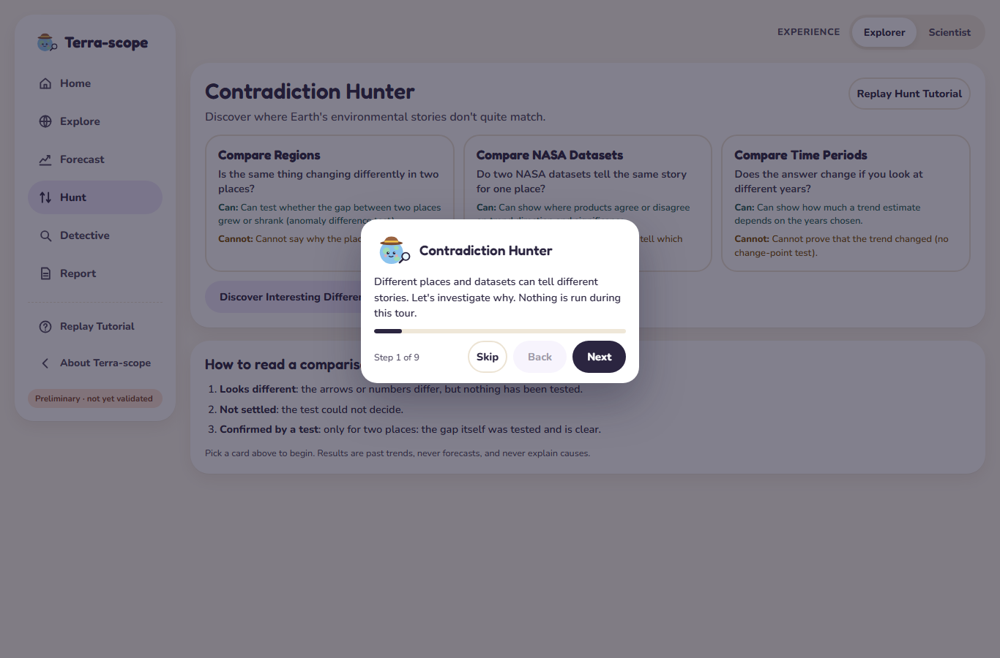
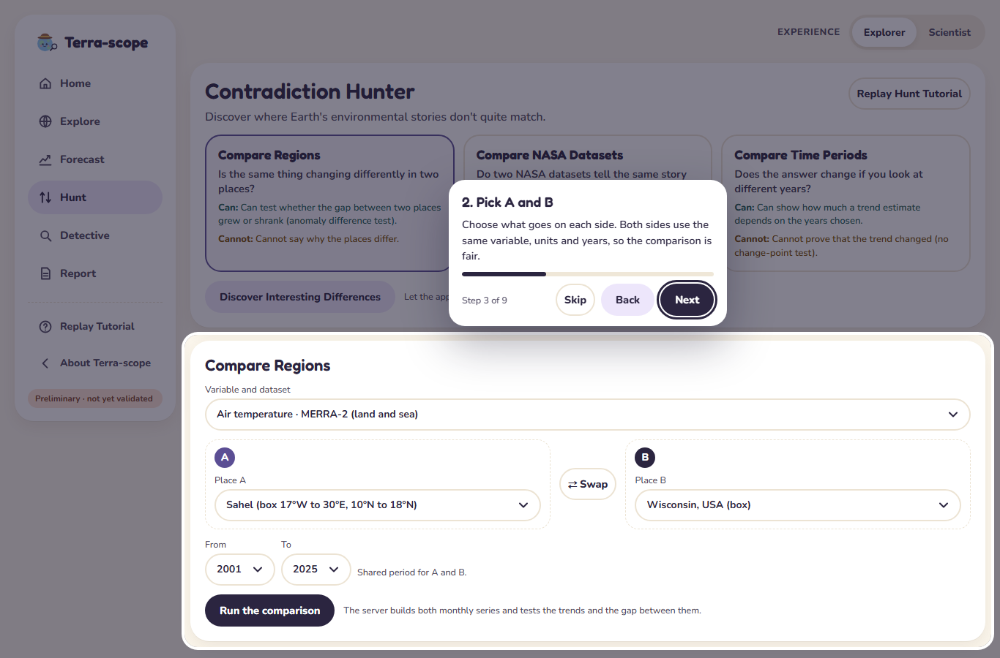
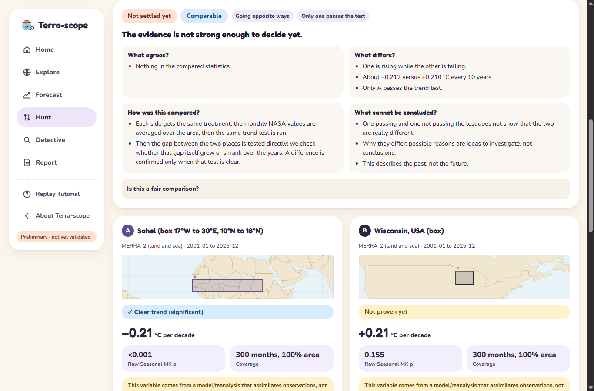
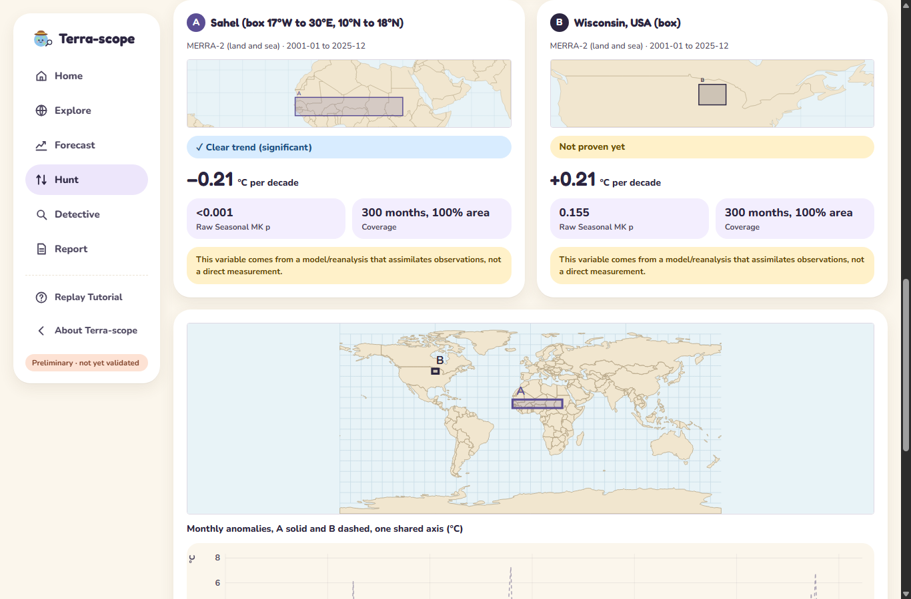
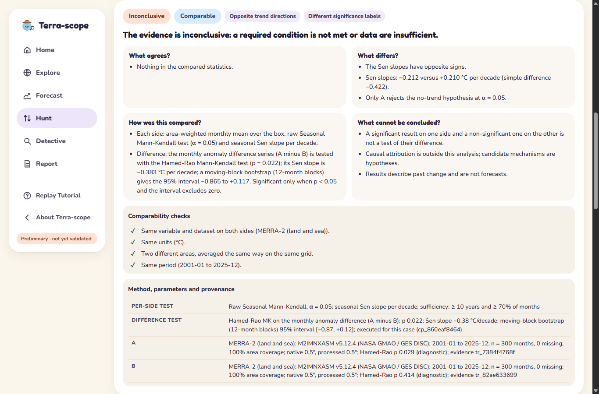
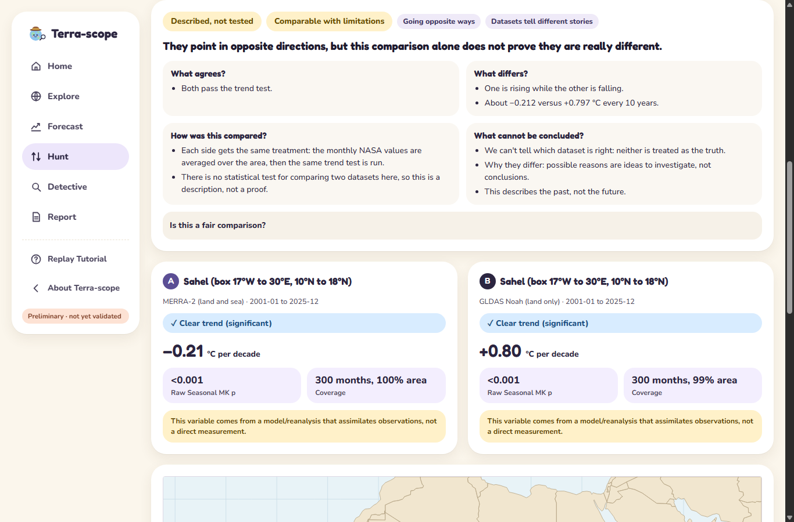
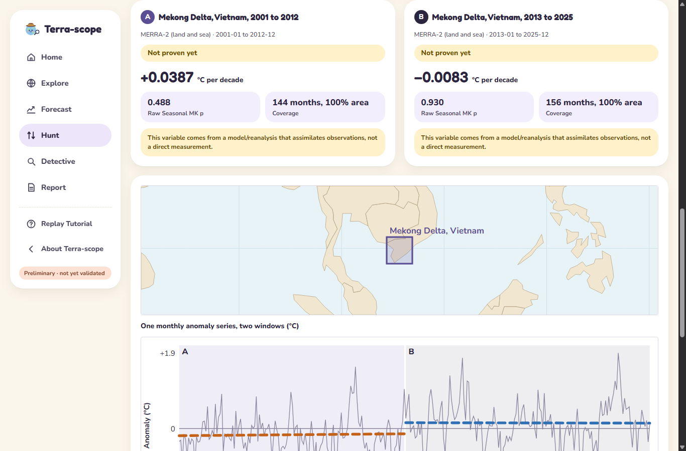
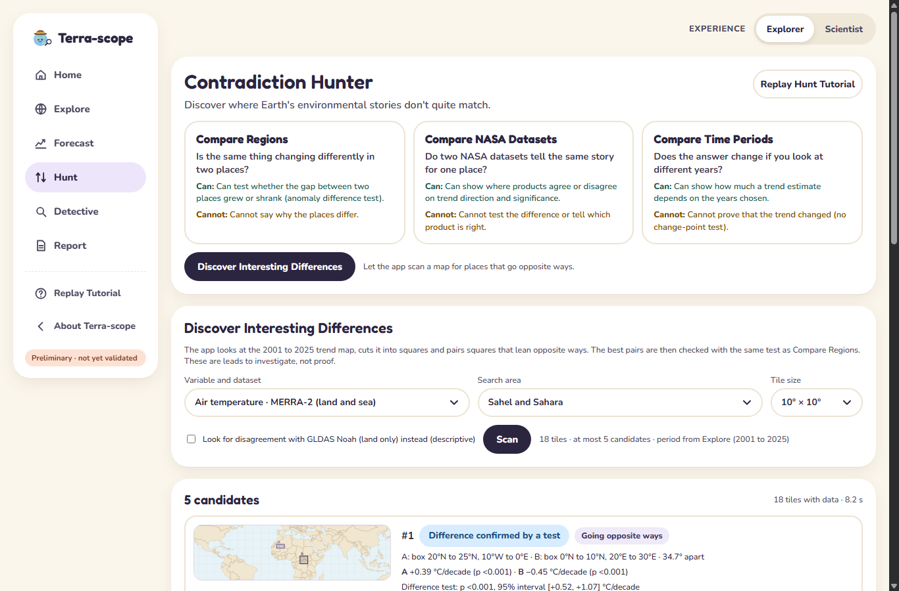
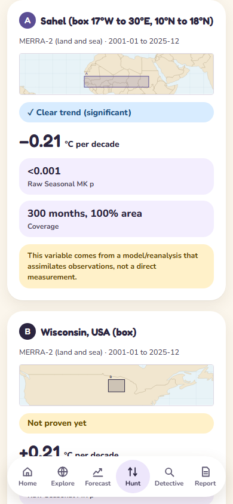
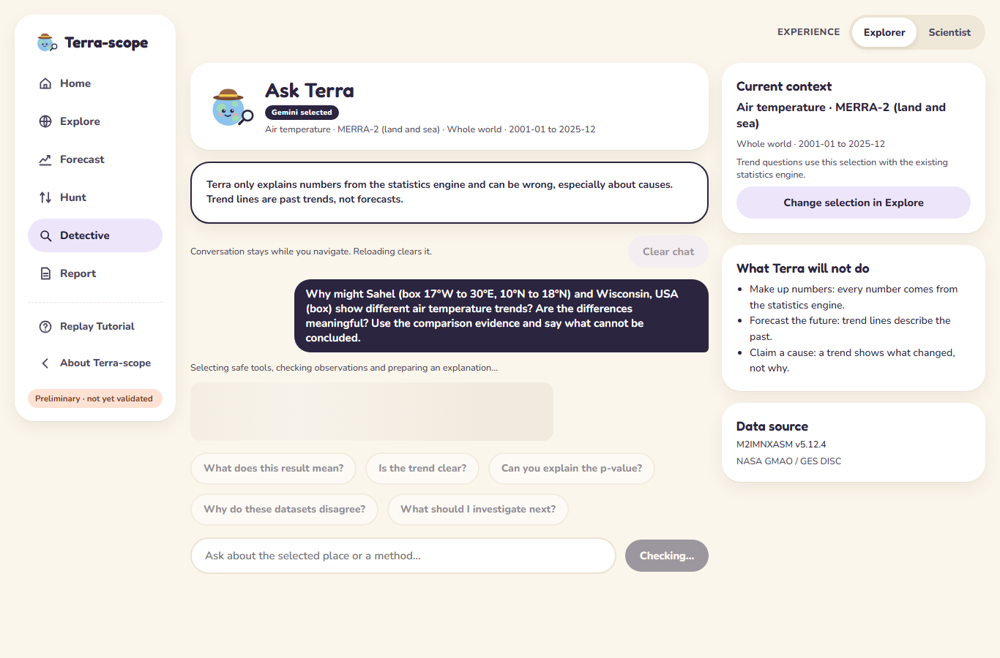

# Contradiction Hunter 3.0

Date: 15 November 2026. Branch `integration/phase7` (on top of `36ad5b3`, not committed). Screenshots: [docs/hunt-v3/](hunt-v3/).

## 1. Goal

Help people discover, compare, investigate and document differences in environmental trend evidence, without overstating what a difference means. Every number comes from the backend (`/trends`, `/series`, `/compare`, `/hunt/discover`). No statistical method, threshold or dataset changed.

## 2. Capability matrix (audit before the work)

| Capability | Before | Now |
|---|---|---|
| Region vs region with a formal difference test (`/compare`) | Working | Kept, new workspace |
| Bounded discovery scan (`/hunt/discover`, regions and datasets) | Working | Kept, new cards and categories, "Investigate this pair" |
| Dataset vs dataset (GLDAS vs MERRA-2, descriptive) | Partial (Explore selection only) | Own mode with compatibility checks |
| Time vs time | Missing | New, reuses `/trends` per window (descriptive) |
| Deterministic comparability checks | Missing | New (`web/src/hunt/logic.ts`) |
| Categories and evidence status | Partial (discovery only) | New for every comparison |
| Detective handoff | Working (regions) | All three modes; identifiers only |
| Add to Report | Working (regions, datasets) | All three modes; report understands "periods" |
| Save investigation | Missing (cases only) | New, local browser only |
| Hunt tutorial | Missing (one step in the main tour) | New, per audience, replayable |
| Synchronized side-by-side trend maps | Missing | Partial: shared-viewport locator map with both areas; per-cell trend maps are not shown side by side |
| Two-dataset or two-period hypothesis test | Not implemented | Still not implemented (requires scientific approval); shown as descriptive |
| Change-point detection | Not implemented | Not added (not approved) |

## 3. Page structure

1. **Header**: "Contradiction Hunter", audience subtitle, "Replay Hunt Tutorial".
2. **Choose an investigation**: three cards (Compare Regions, Compare NASA Datasets, Compare Time Periods), each with a contrasting "Can" (green, ✓) and "Cannot" (orange, dashed, ✕) half, plus "Discover Interesting Differences".
   A second header button, "Same cause, opposite trends" (`web/src/OppositeTrends.tsx`, data in `web/src/opposite.ts`), opens a one-variable finder: `/hunt/discover` with 10° tiles over 180°W to 180°E, 60°S to 80°N, then `/compare` plus two `/series` for the best pair (first `opposite_significant`, else first tested). Entry links `#hunt?opposite[=<variable>&from=&to=]` come from Explore's "Where does it go the other way?", the Home Hunt card and shared links; they skip the Hunt tutorial. A curated card gives one explanation per variable family with checked sources (none for temperature) and always says the cause is not tested. The guide (`#guide`) shows three ready-made pairs.
3. **Landing** (no card chosen): a three-step evidence ladder (looks different, not settled, confirmed by a test).
4. **Workspace** for the chosen mode: variable and dataset, a free place field for A and B (search a preset, country or city; type a point such as `10.8, 106.7` for one grid cell; or a box as `west, south, east, north`; quick picks when empty; "Choose your own coordinates" opens a large world map dialog where a drag draws a box snapped to whole degrees, a click picks one grid cell, four typed edges are the keyboard path, and boxes crossing 180° or smaller than one grid cell are refused), shared period (or two periods), Run, Cancel. The same area chosen two different ways is refused before any request.
5. **Evidence**: status badge, validity badge, category chips, one-sentence conclusion, "What agrees? / What differs? / How was this compared? / What cannot be concluded?", comparability checks; Scientist also gets a method, parameters and provenance table.
6. **A/B panels**: identity, dataset and period, map thumbnail (regions), verdict, Sen slope, raw p, coverage, warnings.
7. **Chart**: shared time axis and one y-axis in common units (regions, datasets: A solid, B dashed); periods: one anomaly series with both windows shaded and each window's own Sen slope. Missing months are gaps.
8. **Actions**: Investigate with Detective, example questions, title and notes, Save Investigation, Add to Report, Open Report.
9. **Saved investigations** list with Reopen (recomputes) and Delete.

State (view, configuration, last result per mode) survives page navigation and Explorer/Scientist switching within the visit.

## 4. Comparison taxonomy (`web/src/hunt/logic.ts`)

Categories (classification only, never a test): `opposite_direction`, `magnitude_difference` (same sign, larger magnitude at least 2 times the smaller), `different_significance_labels`, `dataset_disagreement`, `time_window_sensitivity`, `insufficient_evidence`.

Evidence status:

| Status | Rule |
|---|---|
| `statistically_tested_difference` | Regions only: backend difference test significant (Hamed-Rao p < 0.05 on the A minus B anomaly series and the 95% moving-block bootstrap interval excludes zero) |
| `no_supported_difference` | Regions: test run, p ≥ 0.05 |
| `inconclusive` | Regions: p < 0.05 but the interval includes zero, or p unavailable; any mode with insufficient data |
| `descriptive_difference` | Datasets and periods (no approved test), or regions without a test result |
| `not_comparable` | A failed comparability check |

A significant result on one side and a non-significant one on the other is never labelled a statistically established difference (unit-tested).

## 5. Comparability checks (deterministic)

Physical quantity (datasets: only the pairs in `backend/app/hunt.py` COMPATIBLE), units, same or different area as the mode requires, period equality (regions, datasets) or overlap (periods), window length under 15 years, sufficiency of each side, spatial coverage gap above 5 percentage points, product kind (satellite-based estimate, land-surface model, reanalysis) and native resolution. A failed check gives "Not comparable"; insufficient data gives "More evidence needed"; a limitation gives "Comparable with limitations". Gemini never decides validity.

## 6. Gemini Detective

"Investigate with Detective" sends a question and a context of identifiers only (`intent`, `variable_id`, `region`, `region_b`, `start`, `end`); the backend re-resolves and recomputes the evidence with its tools before the model writes. Regions use the `compare` intent. Datasets and periods use the `trend` intent for side A, because the chat context has no second dataset or second period field; the question names side B and asks the model to say that no two-dataset or two-period test exists. No client number is sent as evidence.

## 7. Investigations and report

Saved investigations (`terra-scope:investigations:v1`, up to 30, this browser only) hold mode, both configurations, evidence IDs and statistics, comparison result, categories, status, validity, limitations, method, discovery reason and the user's title and notes. Untrusted JSON is validated (`parseInvestigation`); notes are text, never evidence. Add to Report places the comparison in both report editions; period comparisons print as "descriptive comparison of two periods".

## 8. Hunt tutorial

- Steps (9): welcome, choose an investigation, pick A and B, run, maps and charts, evidence, Detective, save and report, finish ("Start Investigating", "Replay Hunt Tutorial").
- Separate keys: `terra-scope:hunt-tour:explorer:v1`, `terra-scope:hunt-tour:scientist:v1`; storage failures are handled.
- Starts automatically only when the user enters Hunt, the main tour is closed, no Explore analysis is running and the audience's Hunt tour was not completed. Switching Explorer/Scientist while on Hunt never starts it (found and fixed during browser QA).
- Steps 3 and 4 ask the page to show Compare Regions (a view switch, no computation). Steps about results show a short explanation when no result exists yet, instead of an invisible highlight.
- Reuses the main `Tour` component: Next, Back, Skip, Escape, arrow keys, focus trap, progress bar, spotlight, mobile placement; reduced-motion users get no transitions. The main "Replay Tutorial" is unchanged.
- No Gemini call and no NASA computation during the tour.

## 9. Explorer and Scientist

Same requests and numbers. Explorer: plain subtitles, "Can/Cannot" in everyday words, friendly status labels ("Not settled yet"), checks under "Is this a fair comparison?". Scientist: method wording with test names, status labels such as "Inconclusive", checks open by default, method/parameters/provenance table (difference test p, Sen slope, bootstrap interval, compare ID, per-side n, coverage, native and processed resolution, Hamed-Rao diagnostic).

## 10. Performance and reliability

Region comparison: one `/compare` and two `/series` requests in parallel. Datasets: two `/trends` and two `/series`. Periods: two `/trends` and one `/series`. A request counter discards stale results (Cancel stops the display; the server request itself is not aborted for `/compare`, which has no abort signal). Discovery keeps its backend limits (600 tiles, 5 candidates, 5 re-tests) and an AbortController. No progress percentages.

## 11. Accessibility

Cards are buttons with `aria-pressed`; A/B are identified by letters as well as colour; check results carry a text label ("OK", "Limitation") for screen readers; charts have descriptive `aria-label`s; tour keyboard support and focus trap; phone layout stacks A/B with no horizontal scroll.

## 12. Tests

See section 14 for totals.
- `web/tests/hunt.test.mjs` (9): categories, significance-label rule, two-condition region rule, comparability (incompatible datasets, invalid units, same region, period mismatch, coverage, overlap, short windows), wording never overstates, Detective handoff carries identifiers only, investigation validation and blocked storage, Hunt tour state and targets, report rendering of a period comparison.
- `web/e2e/hunt.e2e.mjs` (Chrome headless, real backend): first-visit tour, Next/Back, keyboard, fallback step, Escape, no overlay left; Sahel vs Wisconsin numbers equal `/compare`; mode switch with zero requests and no tour; Scientist method table; Save Investigation (stored evidence equals `/compare`); Add to Report; invalid selection is refused; MERRA-2 vs GLDAS over the Sahel equals `/trends` and is descriptive; Mekong Delta 2001 to 2012 vs 2013 to 2025 equals `/trends`; bounded discovery and "Investigate this pair"; Report lists "Two regions · from Hunt"; return visit without tour, Replay, Skip; Reopen recomputes; phone layout; Detective handoff sends a chat request. Screenshots in `web/e2e/out/hunt/`.
- `web/e2e/app.e2e.mjs`: Hunt steps updated to the new page.

## 13. Known limitations

- Datasets and periods have no formal difference test; they are descriptive by design until a method is approved.
- Discovery selects and re-tests candidates on the same data (selection effect); the page says to treat them as leads.
- The Detective receives side A's context for dataset and period comparisons (the chat schema has no second dataset or period).
- Side-by-side per-cell trend maps are not implemented; maps show the study areas only.
- Cancel hides a running comparison but cannot abort the server-side `/compare` request.

## 14. Results

Full run on 15 November 2026 (`scripts/test-all.ps1`, backend on :8000 in Gemini mode, web on :5173):

| Suite | Result |
|---|---|
| Backend unit | 258 passed |
| Python dependencies | OK |
| Frontend typecheck | OK |
| Frontend unit | 65 passed (9 new in `hunt.test.mjs`) |
| Production build | OK |
| Live API + report PDF (real NASA data) | 26 passed, 5 skipped (Gemini-only checks) |
| Browser e2e (app + Explorer report + Hunt) | 13/13 passed |

The first full run had one browser failure: a missing `favicon.ico` (404) was counted as a page error in the Explorer report e2e; that filter now matches the other e2e files. A rerun had a Vite HMR WebSocket refusal while the dev server restarted; the next rerun passed 13/13. The Detective step sent a real chat request (Gemini mode); its answer content is checked by `app.e2e.mjs`.

Screenshots:          

## 15. Run locally

```
cd terra-scope-ai/backend; ../.venv/Scripts/python.exe -m uvicorn app.main:app --port 8000
cd terra-scope-ai/web; npm run dev
cd terra-scope-ai/web; npm run test
cd terra-scope-ai/web; node --test e2e/hunt.e2e.mjs
cd terra-scope-ai; powershell -ExecutionPolicy Bypass -File .\scripts\test-all.ps1
```
