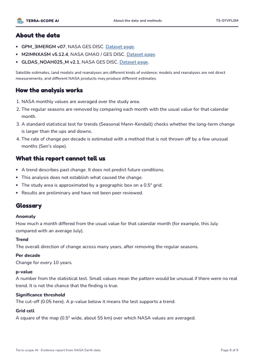
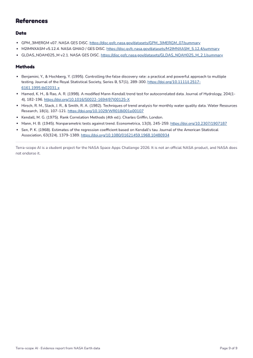
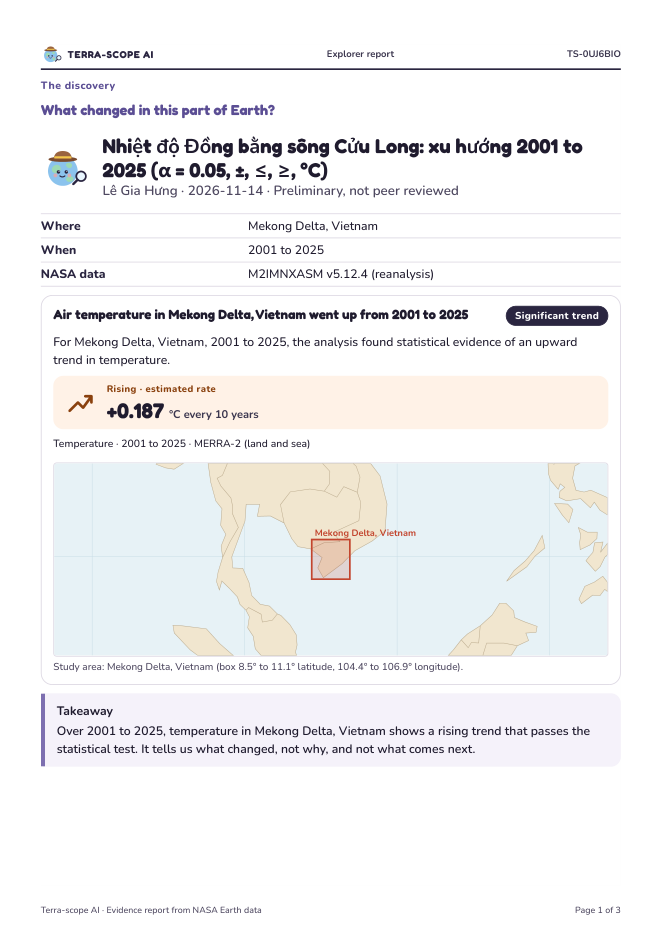
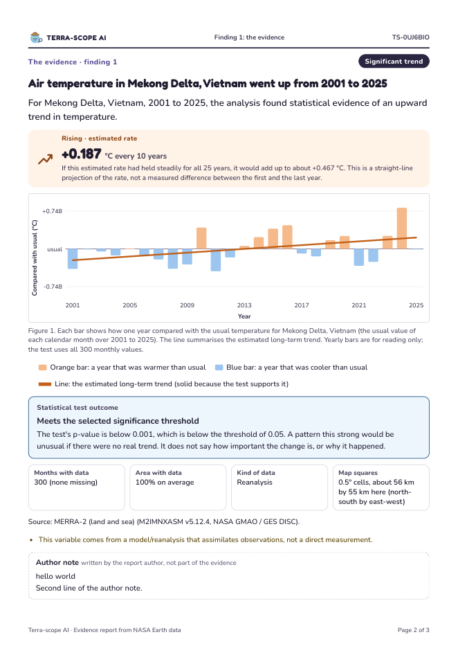
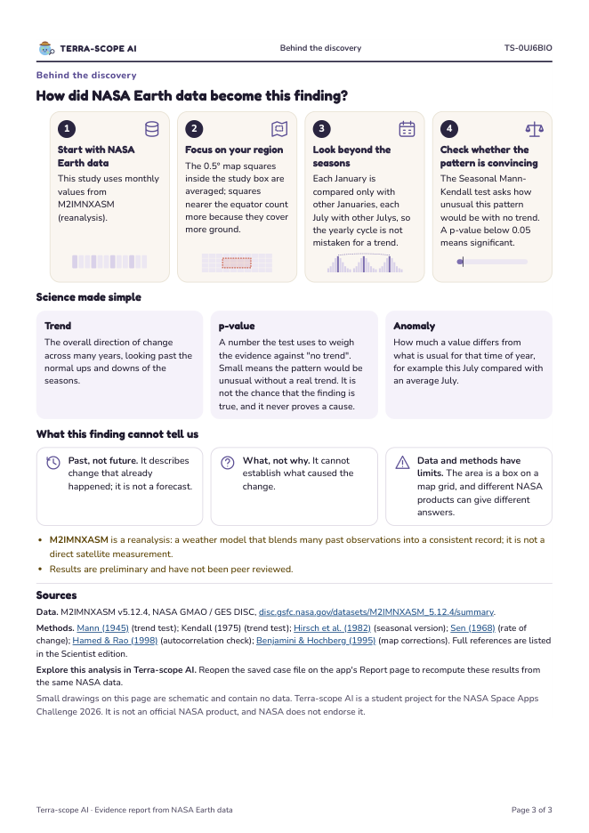
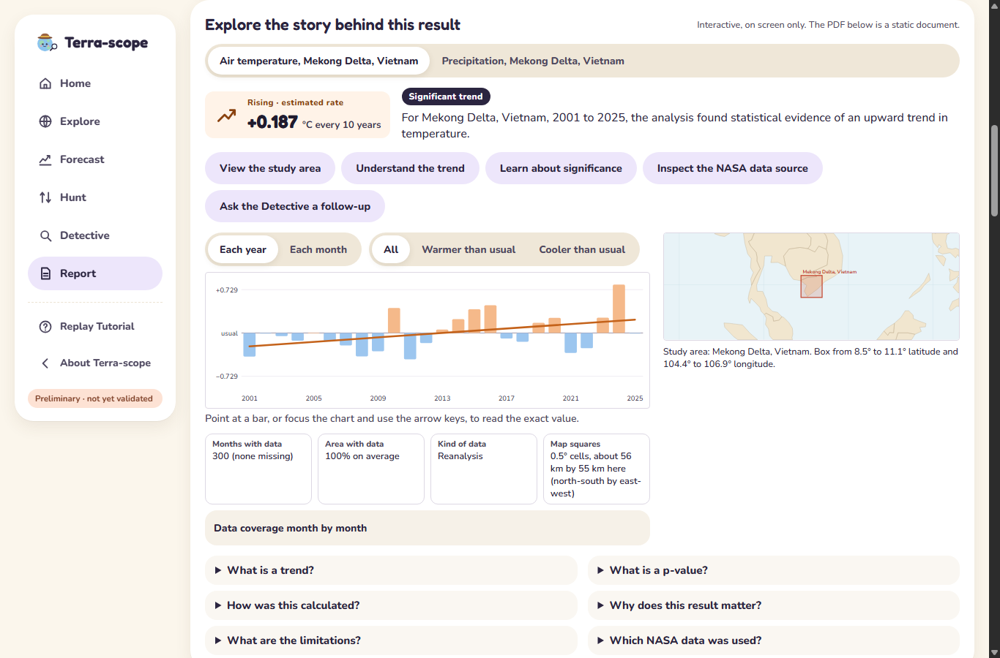
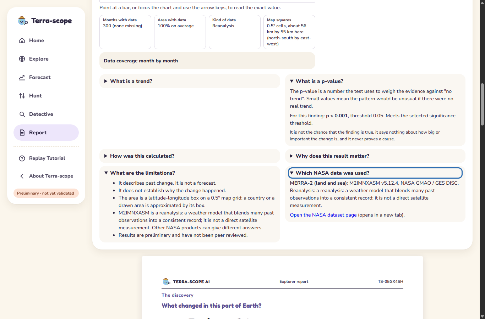
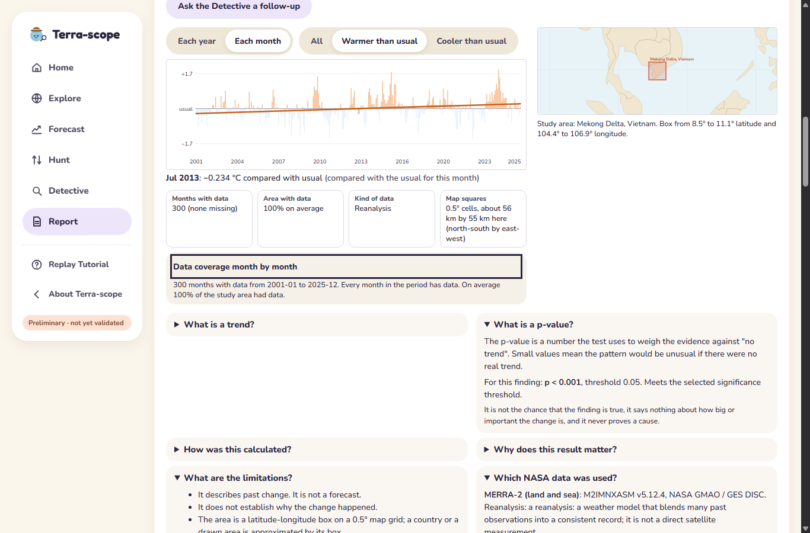
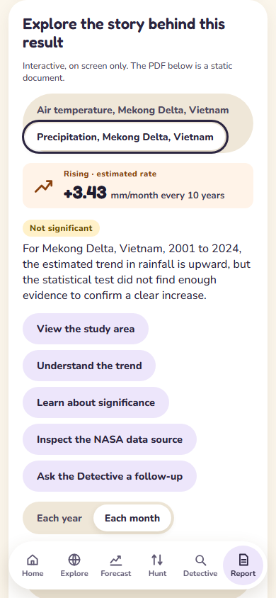

# Explorer report 2.0

Date: 15 November 2026. Scope: the Explorer (non-scientist) edition of the report, as a printed PDF and as an interactive page in the app. The Scientist edition keeps its content; no statistic, threshold, dataset or method changed.

Sample files and images: [docs/explorer-report/](explorer-report/).

## 1. What was wrong

The requested examples `last-non.pdf` and `last.pdf` are not in the workspace. The "before" images come from the last Explorer PDF the project generated (`web/e2e/out/scientific/report-explorer.pdf`, page images in `validation/results/pdf_pages/`).

| Before | Problem |
|---|---|
|  | "About the data and methods" was a wall of text: four lists, a six-entry glossary and the full bibliography. It also said "the regular seasons are removed" before the test, which is not what Seasonal Mann-Kendall does, and described a grid cell as "about 55 km" everywhere. |
|  | The bibliography overflowed onto a last page with no header that was mostly empty. |

The summary also turned the rate into a total ("adds up to roughly +8.23 mm/month") even when the trend was not significant, and without saying that it was a straight-line projection.

## 2. New structure (dynamic pagination)

"Show first, explain second, give technical details on request."

| Page | Content |
|---|---|
| The discovery | Kicker and the question "What changed in this part of Earth?"; the user's title and author; where, when and which NASA data (with its kind: satellite-based estimate, land-surface model or reanalysis); one card per finding with the verdict stamp, a plain sentence, the estimated rate with a direction icon and the word Rising or Falling (not colour alone), and a map of the study area; a short, cautious takeaway. With several findings, one map shows all areas and the cards sit in two columns. |
| The evidence (one per finding) | Headline, plain sentence, rate box; for significant trends only, a labelled straight-line projection over the period; the yearly bar chart with axis titles, caption and legend (no trend line or legend entry when no test was run); the test outcome in words; four data-quality tiles (months with data, area with data, kind of data, map-square size); author note. |
| Comparison (if any) | Unchanged from the previous Explorer edition. |
| Behind the discovery | "How did NASA Earth data become this finding?": four illustrated steps (Start with NASA Earth data; Focus on your region; Look beyond the seasons; Check whether the pattern is convincing), three "Science made simple" cards chosen for this report, "What this finding cannot tell us" as three tiles plus the dataset-specific caveats, and a compact Sources block with clickable NASA dataset links and short method references with DOI links. |
| Technical appendix (optional) | Full statistics table, the glossary and the full references. |

A one-finding report is now 3 pages instead of 4, with no references-only page. Figures keep their captions (`break-inside: avoid`), and headings do not end a page.

  

## 3. Scientific wording changes

| Item | Before | After |
|---|---|---|
| Seasons | "The regular seasons are removed by comparing each month with the usual value" | "Each January is compared only with other Januaries, each July with other Julys, so the yearly cycle is not mistaken for a trend." (what Seasonal Mann-Kendall does) |
| Total over the period | "adds up to roughly +8.23 mm/month" for every result | Only for significant trends: "If this estimated rate had held steadily for all N years, it would add up to about X. This is a straight-line projection of the rate, not a measured difference between the first and the last year." |
| Grid cell | "0.5° wide, about 55 km" | About 56 km north-south; east-west given for the study area's latitude, or as a range for tall areas ("from about 56 km down to 0 km" for the whole world). |
| Data kind | "models and reanalyses are not direct measurements" (generic) | Per product: IMERG is a satellite-based estimate adjusted with rain gauges; GLDAS is a land-surface model, not a direct measurement; MERRA-2 is a reanalysis, not a direct satellite measurement. |
| p-value | glossary entry at the end | Card next to the method: weighs the evidence against "no trend"; not the chance the finding is true; never proves a cause. |
| Insufficient data | trend line and "dashed" legend drawn from a slope that was never tested | no line, no legend entry, "No rate estimated" and a "Not tested" card |

Unchanged: Sen slope, p-values, verdicts, sufficiency rule, regions, coverage, provenance, method versions. Every number in the Explorer PDF comes from the report model built from the backend responses.

## 4. Interactive Explorer report (web)

On the Report page, step 3, with the Explorer edition selected, a panel "Explore the story behind this result" appears above the preview. It is marked `noprint` and says that it is on screen only.

| Feature | Behaviour |
|---|---|
| Finding picker | One button per finding. |
| Rate and verdict | Same rate, direction word and stamp as the PDF. |
| Story steps | View the study area (scrolls to the map); Understand the trend; Learn about significance; Inspect the NASA data source (each opens its explanation); Ask the Detective a follow-up (sets the Explore selection to this finding and opens Detective; disabled when the finding came only from a reopened case). |
| Chart | Real values only. "Each year" (yearly mean of the monthly anomalies, as in the PDF) or "Each month" (every monthly anomaly; months without data drawn as grey stubs). Highlight "warmer/wetter than usual" or the opposite. Hover, or focus the chart and use Left, Right, Home, End, to read the exact value in a live region. |
| Coverage | Data-quality tiles and a "Data coverage month by month" disclosure listing every month without data. |
| Map | Study area box on a world map with its coordinates. |
| Explanations | Native `
` cards: What is a trend? What is a p-value? How was this calculated? Why does this result matter? What are the limitations? Which NASA data was used? Each uses this finding's numbers. No Gemini call. |

PDF connection: no public deployment URL exists, so there is no QR code and no link to localhost. The PDF says "Explore this analysis in Terra-scope AI. Reopen the saved case file on the app's Report page to recompute these results from the same NASA data."

   

## 5. Accessibility

- Direction is shown by an icon and a word (Rising, Falling, Not tested), not by colour alone; the dashed or solid trend line is explained in the legend.
- The chart is one focusable group with an `aria-label` and keyboard reading; the value appears in a `role="status"` live region.
- Explanation cards are native `
`/`
`, so they open with Enter or Space; focus outlines are visible.
- Smallest printed text: 7.5 pt or more for at least 98% of text, nothing under 6.5 pt (tested); body text 9 to 12 pt.
- Light backgrounds with dark text; the report reads in grayscale because stamps and rates carry words.

## 6. PDF export

Unchanged path: the browser's own print ("Save as PDF"), so text stays selectable and searchable and links stay clickable. The interactive panel, the wizard and the mode switch are not printed. Page numbers and the footer come from `@page`. User titles, author names and notes are printed as typed.

## 7. Tests

New or changed tests:
- `web/tests/explorer.test.mjs`: Explorer sections present; no full glossary or unlabelled total in the main report; no "seasons are removed" wording; projection only for significant results; product kinds and grid sizes; concept selection; the interactive chart has one bar per year or per month, keyboard attributes, highlight, and makes no network call.
- `web/tests/pages.test.mjs`: the Report page in Explorer mode shows the new sections and the six explanation cards.
- `web/e2e/report-pdf.mjs` + `backend/tests_e2e/test_report_pdf.py`: real PDFs for 8 Explorer scenarios (significant increase, significant decrease, positive not significant, negative not significant, insufficient data, whole world, single 0.5° cell, multiple findings with three NASA products and a comparison; long title, Vietnamese title and author names, long author note). Checks: text layer on every page, structure, numbers equal to the backend `/trends`, projection only when significant, honest data kinds, grid size range, no references-only page, one-finding reports are 3 pages, readable font sizes, links, no controls or localhost printed, nothing outside the page.
- `web/e2e/explorer-report.e2e.mjs` (Chrome headless): numbers equal to the backend; journey buttons open the right explanation; Enter opens a card; NASA link equals the dataset URL; keyboard reading equals the yearly means of the backend anomalies; hover in the monthly view equals the backend anomaly; highlight dims exactly the months on the other side of usual; coverage list; switching findings; no horizontal scroll at 390 px; Explorer to Scientist and back makes 0 requests; PDF printed after interacting; Detective opens. Screenshots in `web/e2e/out/explorer/`.

## 8. Results

Full run with `scripts/test-all.ps1` on 15 November 2026 (backend on :8000 in Gemini mode, web on :5173):

| Suite | Result |
|---|---|
| Backend unit | 258 passed |
| Python dependencies | OK |
| Frontend typecheck | OK |
| Frontend unit | 56 passed |
| Production build | OK |
| Live API + report PDF (real NASA data) | 26 passed, 5 skipped (Gemini checks, not run) |
| Browser e2e (app + Explorer report) | 12/12 passed on rerun |

In the first full run the Detective step of `app.e2e.mjs` failed once: Gemini was temporarily unavailable and the backend answered in Template Mode without a verified tool result. Two reruns passed. No backend or Detective code was changed in this task. The old Report e2e assertion that looked for "Summary of findings" and "Glossary" in the Explorer edition was updated to the new section names.

Scientific checks: the Explorer PDFs of 8 scenarios print the same Sen slope, verdict and p-value wording as `/trends` returns for the same request; the interactive chart's keyboard readout equals the yearly means of the `/series` anomalies, and the hover readout equals the monthly anomaly. The Scientist PDF tests (research question, statistics, criteria, methods, references) still pass.

## 9. Known limitations

- With three or more findings plus a comparison, the discovery page continues on a second page (dynamic pagination; that page has no running header).
- A very long author note continues on its own page, as typed.
- Mini drawings in "Behind the discovery" are schematic; the page says so.
- The interactive panel needs the finding to have been run in this visit for "Ask the Detective"; a reopened case recomputes the results, so this normally holds.
- No QR code or web link in the PDF until there is a public deployment.
- The Scientist edition still draws its trend line for findings with insufficient data in its monthly chart (unchanged on purpose in this task).
